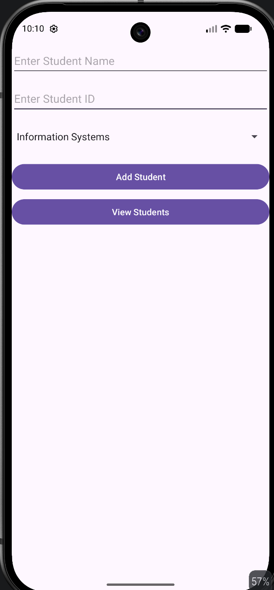
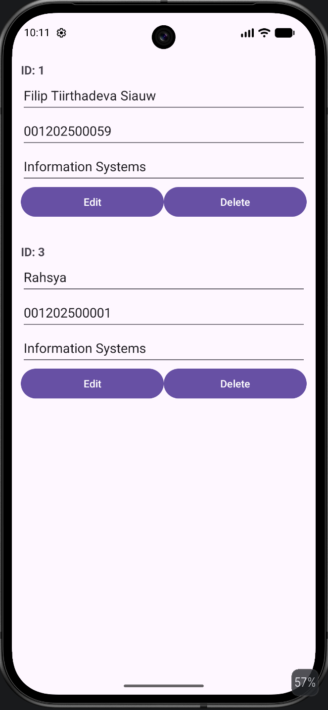

# Question

Create a mobile application that utilizes SQLite database that can store data based on the image. Note that you may put the ADD, EDIT, DELETE, VIEW buttons as you wish. MAKE SURE THE STUDENT ID IS UNIQUE

Case 1: Student Name, Student ID, Major (Informatics / Information Systems)

---

## Application Results

| Main Screen (Input Form) | View Screen (Student List & CRUD) |
|:---:|:---:|
|  |  |

---
